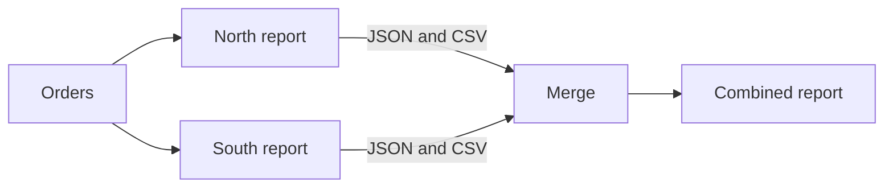

# Gregale Run customer examples

Five scenarios showing how an application or Agent turns a bounded tool call
into validated JSON and files. The handlers use standard libraries, integer money
and fixture data. They need no model key, Internet connection or package build.

| Scenario | Customer problem | What Run contributes | Output |
| --- | --- | --- | --- |
| [Sales report](sales-report/handler.mjs) | Turn an uploaded CSV into a usable report | Separate file inputs, isolated code, result contract, retained exports | Summary JSON, CSV and HTML |
| [Invoice audit](invoice-audit/handler.py) | Find inconsistent structured invoices before importing them | Python execution, exact cents, machine-readable outcome and rejection details | Audit JSON and rejected-invoice CSV |
| [Parallel reports](report-pipeline/handler.mjs) | Process regions independently, then combine their results | Version-pinned tasks, parallel branches, result and artifact handoffs, live progress | Combined HTML and provenance JSON |
| [Recovery](#4-recover-after-a-budget-refusal) | Finish a report without recalculating healthy branches | Admission budgets, immutable completion, explicit rerun and verified reuse | Two reused reports, one newly executed merge |
| [Report Agent](agent/agent.mjs) | Let an Agent request a report and respond when it is ready | Delegated tools, durable inbox continuation, scoped receipts and artifacts | Final answer with an app-owned report reference |

## Run locally

From the repository root:

```sh
cd examples/gregale-run
npm run demo
npm test
npm run prepare
```

Use Node.js 22+ and Python 3.12+ (`PYTHON=/path/to/python` selects an interpreter).
No `npm install` is needed. Published tasks target `node24` and `python313`.
Open `.output/local/sales-report/report.html` and
`.output/local/pipeline-merge/combined.html`. Expected fixture results:

- Sales: **4 orders, 8 units, 6,996 USD cents**.
- Invoices: **1 accepted, 2 rejected, 3,897 accepted USD cents**.
- Pipeline: **2 regional reports, 4 orders, 6,996 USD cents**.

The local demo calls the real handlers and stages files locally. Tests exercise
the Agent adapter with in-memory transport/storage doubles. These checks do not
start a microVM, prove durable delivery across process restarts, or qualify a
deployed runtime. Recovery requires the live platform walkthrough below.

## Before running against Gregale

Use a CLI built from this checkout and an authenticated test account. The task,
extended-admission, pipeline and Agent lanes are previews; operators must enable
their existing gates. These examples do not change deployment configuration.

```sh
gregale sandbox capabilities --json
gregale run tasks list --json
```

Check `admission_available`, `extended_admissions`, both target runtimes, and
`task_pipelines` for the pipeline scenarios. Recovery also needs
`run_controls.configuration_available`. Publication and budget configuration need
account deploy/write authority. Agent invocations use the app's workload identity
and a live thread callback. See [Run tasks](../../docs/run-tasks.md),
[pipelines](../../docs/run-pipelines.md) and [controls](../../docs/run-controls.md).

Cloud commands below consume normal Run/storage allowances. Choose unused task
prefixes before publication. The basic examples publish three names; recovery
publishes two more. Retired names still count against preview catalog quotas.
Tasks are immutable: changing code, schemas or endpoint delegation needs a new
version. Keep the generated original pipeline manifest for recovery; it contains
input data and belongs in your application's protected storage.

## 1. Uploaded CSV to sales report

A SaaS application accepts an order export and returns a small summary to its UI,
plus CSV/HTML downloads. CSV data is separate from source and JSON input.

```sh
gregale run --runtime node24 --file sales-report/handler.mjs \
  --input @sales-report/input.json \
  --input-file orders.csv=sales-report/orders.csv \
  --input-schema sales-report/input.schema.json \
  --result-schema sales-report/result.schema.json \
  --artifact-storage stored --max-artifact-bytes 32768 \
  --output-file summary.csv --output-file report.html \
  --idempotency-key gr-demo-sales-file-001 \
  --output-dir .output/cloud-sales --json
```

Keep the same request and idempotency key after a lost acknowledgement. For a new
dataset, use a new key. Declared files are exported; the guest filesystem is
disposable. Retained files expire after 24 hours, so copy customer deliverables
into app-owned storage when longer retention is needed. HTML is escaped and CSV
formula markers are prefixed. Money is an integer number of USD cents.

For repeated use, publish once and invoke with JSON rows:

```sh
npm run prepare -- --prefix gr-demo
gregale run tasks publish --manifest generated/sales.task.json
gregale sandbox task call gr-demo-sales@v1 --input @sales-report/rows.json \
  --idempotency-key gr-demo-sales-task-001 \
  --output-dir .output/task-sales --json
```

## 2. Structured invoice audit

An import service checks line-item arithmetic, duplicate IDs and invalid
quantities before admitting invoices into its own database. The tool reports
business rejections as data; it does not discard the entire batch. It reads
structured JSON, not PDFs, and does not perform OCR or tax validation.

```sh
gregale run tasks publish --manifest generated/audit.task.json
gregale sandbox task call gr-demo-audit@v1 --input @invoice-audit/input.json \
  --idempotency-key gr-demo-invoices-001 \
  --output-dir .output/cloud-invoices --json
```

Prices are decimal strings such as `"12.99"`, converted exactly to integer cents.
`audit.json` explains each rejection; `rejected.csv` can be returned to the
customer. Input/result schemas describe the tool contract. A succeeded execution
with `result_validation.status: "invalid"` must be treated as a failed tool result.
The CLI wait/download path returns nonzero for that condition.

## 3. Parallel regional report with live progress

The application submits a graph, then can exit. North and south run independently;
merge receives both validated JSON results and both declared `summary.csv` files.
Every physical task invocation gets its own disposable Run.



```sh
gregale run tasks publish --manifest generated/merge.task.json
mkdir -p .output/pipeline
gregale sandbox workflow run --managed --manifest generated/pipeline.json --json \
  > .output/pipeline/accepted.json
```

The response's `id` is the pipeline UUID. Its `workflow_id` is `gr-demo-reports`.
Observe using the UUID, then fetch the terminal completion using the workflow ID:

```sh
gregale sandbox workflow watch PIPELINE_UUID --after 0 --json
gregale sandbox workflow gr-demo-reports --json > .output/pipeline/completion.json
```

A completed watch means observation ended; check
`managed[].pipeline.completion.outcome` for the accepted `managed[].id`. It must
be `succeeded`. The merge step's last `attempts[].run_id` identifies its receipt:

```sh
gregale sandbox status MERGE_RUN_UUID --json
gregale sandbox artifacts MERGE_RUN_UUID --output-dir .output/cloud-combined
```

The CLI verifies file lengths and SHA-256. `combined.json` includes each input
CSV's checksum. Resubmit the unchanged manifest/workflow ID to recover an uncertain
submission; choosing a new workflow ID requests new work. Progress events contain
metadata; use individual Run streams for logs. Resume with the last
`next_sequence`, and resynchronize from `progress` if a page reports `gap`.

## 4. Recover after a budget refusal

This intentionally refuses **merge admission**, rather than injecting a random
runtime failure. North and south succeed; the daily merge invocation allowance
is zero. Raise it, create a child pipeline and reuse the two healthy outputs.
Run this on an ordinary account pipeline, not an Agent callback pipeline.

Use an unused prefix. `expected_revision: 0` creates a new policy and refuses to
overwrite an existing one. Task policies cover every version of a name.

```sh
npm run prepare -- --prefix gr-recovery --out generated/recovery
gregale run tasks publish --manifest generated/recovery/sales.task.json
gregale run tasks publish --manifest generated/recovery/merge.task.json
gregale sandbox task budget gr-recovery-merge \
  --manifest generated/recovery/budget-hold.json
mkdir -p .output/recovery
gregale sandbox workflow run --managed --manifest generated/recovery/pipeline.json --json \
  > .output/recovery/parent-accepted.json
gregale sandbox workflow watch PARENT_PIPELINE_UUID --json
gregale sandbox workflow gr-recovery-reports --json > .output/recovery/parent.json
```

Use `id` from `parent-accepted.json` for `PARENT_PIPELINE_UUID`. Wait for the parent
completion: outcome `failed`, north/south successful, merge with zero attempts.
Read the current policy; the next command expects revision **1**. After an
uncertain policy write, read it again instead of blindly advancing its revision.
Stop on a revision conflict and inspect the policy.

```sh
gregale sandbox task budget gr-recovery-merge --json
gregale sandbox task budget gr-recovery-merge \
  --manifest generated/recovery/budget-release.json
gregale sandbox workflow retry PARENT_PIPELINE_UUID gr-recovery-fixed \
  generated/recovery/pipeline.json --json > .output/recovery/child-accepted.json
gregale sandbox workflow watch CHILD_PIPELINE_UUID --json
gregale sandbox workflow gr-recovery-fixed --json > .output/recovery/child.json
node scripts/check-recovery.mjs .output/recovery/parent.json .output/recovery/child.json \
  PARENT_PIPELINE_UUID CHILD_PIPELINE_UUID
```

Use `id` from `child-accepted.json` for the child UUID. Expected verifier output:
`reused_reports: 2`, `new_attempts: 1`, plus the merge Run ID for artifact download.
The two reused steps must have the original `reused_run_id`, matching output
fingerprints and **zero new attempts**. The parent remains unchanged.

No `--repeat-steps` is required because merge was never admitted. A previously
started failed step and its previously started affected descendants need explicit
acknowledgement, for example `--repeat-steps render,notify`. Inspect the required
list on a conflict; do not automatically acknowledge steps with external effects.
The example tools have no external effects. Reuse requires the original key family
and ready outputs within 24 hours. Keep the exact child ID/intent on submission
retry. The demo leaves its merge allowance enabled at one invocation per UTC day;
read the current revision before replacing or disabling that demo policy.

## 5. Report Agent that resumes when the report is ready

[agent/agent.mjs](agent/agent.mjs) wires the existing stateless Node starter to a
scripted report model and `GregalePipelineTools`. A user message contains the
`sales-report/rows.json` object. The first slice persists a stable tool-call ID,
dispatches the pipeline and returns. Its completion wakes a second slice through
the Agent inbox. No Agent process waits for the tools.

Publish sales/merge with explicit delegation **before** the first invocation:

```sh
npm run prepare -- --prefix gr-agent --endpoint-id YOUR_ENDPOINT_UUID --out generated/agent
gregale run tasks publish --manifest generated/agent/sales.task.json
gregale run tasks publish --manifest generated/agent/merge.task.json
```

Use these two names instead of the basic report names if catalog capacity is
limited. Endpoint delegation is part of the immutable version. See the
[stateless Agent starter](../../cmd/gregale/templates/agent-stateless-node/README.md)
for endpoint, Postgres and workload-identity setup. In an application using this
repository, construct the record processor once:

```js
import { createReportAgent } from './examples/gregale-run/agent/agent.mjs';

const processRecord = createReportAgent({
  prefix: 'gr-agent', store, platform,
  destination: { app: 'report-agent', route: 'reports' },
});
// Inside the authenticated realtime trigger; acknowledge only after it resolves.
await processRecord(record);
```

`store` is the starter's transactional Postgres store; `platform` is its
`GregalePlatform` with app workload identity. Configure a private upload route
using [durable artifact delivery](../../docs/run-artifact-delivery.md). Managed
delivery verifies and copies the output on the control plane; Agent code receives
only the receipt and object reference. A pending copy keeps the thread open. The
committed final turn handles redelivery after callback revocation without another
source read or storage write. Your backend authenticates the customer before
issuing a fresh five-minute download URL for that owned delivery. Receipt locators
are authenticated metadata, rather than customer download capabilities.

For an external storage system, pass `reports` instead of `destination`, with
these durable app-owned operations:

| Operation | Required behavior |
| --- | --- |
| `get(key)` | Return an already committed record, or nothing. Keys include endpoint, thread and completion IDs. |
| `putOnce(key, record)` | Atomically retain the bytes and summary, deduplicate concurrent/retried writes, return the committed record with an app-authorized `report_ref` for successful reports. Failed records contain only `outcome`. |

The external-storage bridge fetches the authorized receipt, rejects invalid result contracts,
checks the declared HTML length and checksum, and persists it **before** the
starter finalizes the thread and revokes callbacks. This matters because scoped
Gregale report links stop working after revocation. Cached records make subsequent
inbox redeliveries safe even after the grant is gone. Keep bytes out of model
history. The app must authenticate customer report downloads and retain its
report records for the inbox's replay horizon.

The script uses at most 20 small orders so it fits RAP's 8 KiB envelope. For larger
datasets, upload an orders CSV and use a delegated `gregale_task` call to the same
published sales task. The backend grants the CSV to the call at `orders.csv`,
and the task reads `{"csv_file":"orders.csv"}` from its JSON arguments. Follow
the [scoped input guide](../../docs/run-tasks.md#delegate-an-uploaded-file-to-one-tool-call).
The scripted model can be replaced with a provider while preserving the tool,
contract and persistence flow.

`npm test` exercises two slices, a lost dispatch acknowledgement, completion
redelivery after revocation, managed delivery and pending-copy handling, corrupt
artifacts, storage failures and failed pipelines. The in-memory test adapters are
not a production storage implementation.

The internal KVM acceptance runner provides `report-agent-json` and
`report-agent-files` cohorts. Both use a verified source manifest, the pinned
Node 24 executable and the starter's lockfile-installed dependencies. The test
tasks use 20-second deadlines to include queue time on the two-vCPU node. The JSON
driver forwards durable inbox records into fresh worker processes. It shares
the actual hosted control plane and PostgreSQL with the test Runs, using
fixture workload identity and private S3-compatible storage. It simulates
lost responses after dispatch and report delivery, restarts the API and
verifies one terminal inbox result and one retained report. The file cohort
uploads 1,024 orders, admits the named sales task, revokes the upload and
replays the same call across an API restart before the Run boots.

### Deployable Report Agent pilot

Use a dedicated PostgreSQL database, a standalone Node 24 function app, and
an enabled [private HTML upload route](../../docs/run-artifact-delivery.md#configure-a-destination)
on that app. The route must allow `text/html` and at least 32 KiB. A single app
and database can serve multiple authenticated customers through the scoped
backend helper below.

From this example directory, run the starter with Node.js 22.18 or newer,
npm, and a current `gregale` CLI. Set `GREGALE_API_URL` and `GREGALE_TOKEN`
for the pilot account and `DATABASE_URL` to the same database connection
the deployed function should use. The database must be reachable from both
the setup machine and the function. The setup credential needs app and
deployment read/write, env and secret write, and object read authority.

Reserve the app, then configure the private upload route before running setup.

```sh
FAAS_API="$GREGALE_API_URL" FAAS_TOKEN="$GREGALE_TOKEN" \
  gregale deploy --name report-agent --function --runtime node24 --create-only
```

```sh
npm run setup:report -- --app report-agent --route reports
```

Setup applies the database schema, creates the `agent` endpoint, publishes
endpoint-scoped version 1 sales and merge tasks, and deploys the Node 24
handler with the ordered `slices` consumer group and `agent-inbox` trigger.
The receipt includes the app, endpoint UUID, task prefix, pinned task digests,
deployment ID and elapsed time. Keep the returned task prefix in your backend
configuration. A custom prefix can be selected on first setup with
`--task-prefix`.

Use the same inputs to resume after an interruption. The command reuses a
matching deployment, preserves an existing sealed `DATABASE_URL`, and rejects
conflicting runtime configuration. For a preconfigured secret, supply the
matching database connection locally. The platform masks the sealed value.
The function uses the setup API origin by default. It retains an existing
`GREGALE_API_URL` app variable when the function uses a separate API origin.

Add `--verify UUID` with a fresh lowercase UUID for a sample run. Setup will
submit the included four-order CSV, check that the second customer identity
cannot see the report, and fetch and check the signed private HTML. The
verification receipt includes **6,996 cents**, four orders, eight units, and
the time from submission to verified download. The sample consumes Run and
storage usage. Reuse the UUID to resume the same sample after a timeout.
For a standalone source bundle you can inspect or customize, run
`node scripts/hosted-pilot.mjs ./hosted-report-agent report-agent`.

For CSV, use the generated TypeScript helper in your trusted backend. Supply a
node-postgres pool for the pilot database, a server-side Gregale credential
with app access, deploy-write and object-read authority, and the pilot's app,
endpoint, upload route and task prefix. The API needs the retained realtime
preview and the Run task, pipeline and file preview capabilities. Apply the
[scoped pipeline claim fence](../../docs/adr/20261118120000-agent-pipeline-scoped-files.md)
and start compatible workers before accepting CSV traffic.

```ts
import { createReportIntake } from './report-intake.ts'

const reports = createReportIntake({
  db: pool, apiURL, token: backendToken,
  app: 'report-agent', endpointID, uploadRoute: 'reports', taskPrefix,
})
const key = { customerID: session.customerID, requestID: submissionUUID }
const accepted = await reports.submit(key, csvBlob)
const state = await reports.status(key)
const download = await reports.download(key)
```

Use the customer ID from the authenticated session. Generate the submission
UUID once per user action and reuse it with the same bytes on retry. The helper
hashes the file, stages it, persists the exact grant for `csv-report` at
`orders.csv`, and publishes one stable retained inbox message. A reused UUID
with changed bytes is rejected. If the grant expires before the Agent sees
the request, status returns `intake_expired`. Reconcile an uncertain publish
in the inbox before starting a replacement with a new UUID. Keep the request
and grant rows through the inbox replay window. Serve downloads on demand
after checking the customer session. The helper returns a temporary GET
capability once delivery commits and the Agent has persisted its final reply.

For JSON, publish the existing order fixture as the user message data. The
function accepts the gateway's realtime invocation and checks the endpoint,
channel and consumer group. A completed report leaves one private delivery
receipt in the final assistant message in `agent_messages`. The backend can
use the receipt to issue a customer-authorized download URL.

### Customer progress and regional report recovery

Use the same trusted backend helper for a recoverable regional report. Run
`setup:report` again on an existing starter to apply the updated database
schema. Generate a fresh local bundle with
`node scripts/hosted-pilot.mjs ./hosted-report-agent report-agent` and import
its root `report-intake.ts` from your backend.

The backend submits 2–20 orders spanning north and south as an account-managed
Run pipeline. The independent regional steps can both finish if one branch
fails. The merge uses their successful outputs. Use the same Run key family
for submission, reads and reruns, with `runs:read` and `runs:write`. The backend
credential also needs app access and read and write access to the private report
bucket for delivery.

```ts
const customerID = session.customerID
const key = { customerID, requestID: submissionUUID }
await reports.submitRegional(key, orders)

// In an authenticated progress endpoint
const progress = await reports.progress(key, after)
```

Start `after` at zero and pass the response's `pipeline.nextSequence` to the
next poll. When `pipeline.gap` is true, replace the displayed branch state with
`pipeline.snapshot`. Progress contains branch labels, states and safe reasons.
The response excludes Run IDs, log text, receipt links and file grants. Serve
these responses with `Cache-Control: no-store`. The CSV inbox flow exposes its
report-level status through the same method and returns `pipeline: null`.

Show the failed regional report's `recovery.runSteps` and `reuseSteps` before
confirming a rerun. For example, if south failed after starting and merge was
blocked, the customer sees south and merge listed to run, north listed for
reuse, and south as the only step that needs explicit repeat approval.

```ts
// In an authenticated POST handler, after the customer confirms the list
const retry = await reports.rerun(key, {
  requestID: rerunUUID,
  repeatSteps: approvedRepeatSteps,
})
const childKey = { customerID, requestID: rerunUUID }
const childProgress = await reports.progress(childKey, 0)
const download = await reports.download(childKey)
```

Generate the child UUID once. On an uncertain response, retry the same UUID
and approvals. A failed report can reserve one child, and its `childRequestID`
lets the customer find that child after a refresh. The parent remains failed
with its original receipt. If the child's pipeline fails, the customer can
approve a further rerun from that child.

The helper submits the original pinned manifest and exact repeat approvals.
Gregale verifies reuse and refuses expired, revoked or mismatched outputs.
The child reports `rerun_unavailable` when Gregale refuses reuse. Start a fresh
report if reusable outputs are unavailable. Keep the original
regional manifest private in the application database through the rerun window.
Continue showing the report as pending while it is `delivering`, even after
the pipeline journal is terminal. Sign downloads on demand from the
authenticated backend.

To exercise recovery without changing task code, reuse the
[merge budget refusal](#4-recover-after-a-budget-refusal) with
`submitRegional`. Verify that both regional branches succeed and merge is
refused. Lift the merge budget, approve a rerun with `repeatSteps: []`, and
watch the child's two reused branches and fresh merge. Replay the same child
UUID and compare its private download with the original child result.

### Deliver regional reports in the background

Reapply the starter setup to add the delivery columns, then generate a fresh
backend bundle. Set `completionWebhookSecret` on the backend's
`createReportIntake` options and mount `reports.receiveCompletion` as a POST
endpoint that accepts a Fetch API `Request` and returns its `Response`.
Pass the original request before any JSON middleware consumes the body.
Keep the signing secret and the existing trusted Run and storage credential
on the backend. Use a dedicated signing secret for this receiver.

```ts
const secret = process.env.REPORT_COMPLETION_WEBHOOK_SECRET
if (!secret) throw new Error('Set REPORT_COMPLETION_WEBHOOK_SECRET')
const reports = createReportIntake({
  db: pool, apiURL, token: backendToken,
  app: 'report-agent', endpointID, uploadRoute: 'reports', taskPrefix,
  completionWebhookSecret: secret,
})

// Mount this handler at the receiver URL in your backend.
export const POST = reports.receiveCompletion
```

Set the secret before enabling new regional submissions with this configuration.
Register the account subscription before accepting them so their completions
enter the webhook outbox.

```sh
printf '%s' "$REPORT_COMPLETION_WEBHOOK_SECRET" | gregale webhook account add \
  --target-url https://your-backend.example/report-completion \
  --event execution.pipeline.finished --delivery-format cloudevents --from-stdin
```

Each regional request records its delivery mode when reserved. With the webhook
enabled, status and progress reads can show `delivering` while the receiver
copies the output. The customer can leave the page and return for a signed
download. Existing requests and backends without the secret can advance delivery
when status is read. CSV delivery continues through the Agent inbox.

The receiver verifies the signed request and checks the report's stored
workflow identity against the authorized pipeline receipt. It saves the exact
private copy request before calling Gregale storage. If storage is pending or
the receiver is interrupted, Gregale retries the webhook and the receiver uses
the same copy identity. A replay after delivery returns success without writing
another object. The receiver acknowledges unrelated account events without
touching report records. Use the account webhook delivery history to inspect and
redrive dead events. See [account webhooks](../../docs/account-release-webhooks.md).

### Customer report page

Generate a fresh starter bundle to include `report-page.mjs` and its assets.
Mount the returned Fetch handler for `/reports` and its child routes in the
trusted backend. Resolve the customer ID from your existing authenticated
session for each request. Set `publicOrigin` to the browser-facing origin.

```js
import { createReportPage } from './report-page.mjs'

const reportPage = createReportPage({
  reports,
  publicOrigin: 'https://reports.example.com',
  customerForRequest: async request => (await authenticatedSession(request))?.customerID,
})

// In the backend router, pass the incoming Fetch Request through unchanged.
// The handler returns null for paths outside /reports.
```

Use the same `reports` instance for this page and the separately mounted
completion webhook. The page keeps the report request ID in the URL so a
refresh returns to the same report. It uses tab session storage for unconfirmed
submissions and approvals, clears them once confirmed, and sends the same
intent on retry. Keep the page on HTTPS so the browser can generate UUIDs.
The page presents signed downloads as same-origin attachments, with the
storage URL and its required headers handled by the backend.

### Hosted acceptance

For hosted acceptance, publish the four-order JSON fixture and submit a CSV
with 1,024 rows of quantity 2 at 123 cents. The JSON report should total 6,996
cents and the CSV report 251,904 cents. Check the `slices` consumer group's
settlements to verify both records reached the deployed function through the
trigger. Restart the isolated API during processing and replay the same
logical requests. Compare the final receipt before and after redelivery,
verify one private object per report, and verify the second customer cannot
read the request or sign a download. Check that the JSON uses two sales Runs
and a merge and that the CSV uses one sales Run with the file granted to
`csv-report`.

Record first deploy to first verified download separately from per-request
time to completion. Use the intake request timestamps and final assistant
timestamp to split submission and execution time. Record failures by phase and
sum billed Run and artifact storage usage for each successful report, including
any retries.
